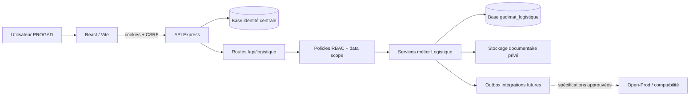
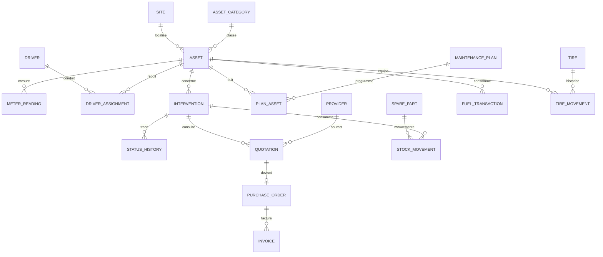

# PROGAD — Cadrage du module Logistique & GMAO

**Statut :** proposition à valider avant implémentation  
**Date d'analyse :** 20 octobre 2026  
**Périmètre de ce document :** architecture, navigation, données, API, habilitations, roadmap et règles métier. Aucun processus métier Logistique n'est encore implémenté.

## 1. Synthèse de décision

Le module doit être ajouté au monorepo PROGAD existant, sous les préfixes `/logistique` et `/api/logistique`, sans nouvelle authentification. La solution recommandée est un domaine métier isolé dans une quatrième base PostgreSQL, relié à l'identité centrale par les UUID des utilisateurs.

Le dépôt possède déjà les bons points d'extension : le code `logistique` est autorisé dans la contrainte de `module_access`, les sessions et droits sont centralisés, le cockpit filtre les applications suivant les accès, et l'API sait protéger un domaine par module. Deux évolutions du socle sont toutefois indispensables avant le MVP :

1. ajouter Logistique à l'écran d'administration, sans exiger d'identité historique Chèques/Impayés ;
2. étendre l'autorisation API au-delà de `read/write/admin`, avec des permissions métier comme `interventions.approve`, `quotations.approve` et `reports.export`.

L'implémentation doit rester incrémentale. La phase 1 doit établir le domaine, les habilitations, le parc, les conducteurs, les prestataires, les interventions, le préventif de base, le tableau de bord et les rapports de base. Les achats, stocks, carburant, pneumatiques, imports et automatisations avancées restent dans les phases suivantes.

## 2. Évaluation de l'architecture PROGAD existante

### 2.1 Organisation et technologies

| Zone | Constat | Conséquence pour Logistique |
|---|---|---|
| Monorepo | Workspaces npm : `apps/web`, `apps/api`, `packages/shared` | Ajouter le domaine au même frontend et à la même API |
| Frontend | React 19, TypeScript, Vite 6, React Router 7 | Créer des routes lazy-loadées sous `/logistique` |
| UI | Tailwind CSS 4, HeroUI, Lucide, Recharts, composants Impayés réutilisables | Réutiliser tokens, cartes, tableaux, badges, états vides et graphiques |
| Backend | Node.js ESM, Express 4, JavaScript | Créer `apps/api/src/domains/logistique` selon les conventions existantes |
| Données | PostgreSQL via `pg`, bases centrale/Chèques/Impayés séparées, Open-Prod en lecture seule | Ajouter une base Logistique dédiée et un pool propre |
| Validation | Zod côté API, requêtes SQL paramétrées | Centraliser les schémas Logistique et valider body/query/params |
| Fichiers/import | Multer et `xlsx` déjà présents | Réutilisables, avec une couche de stockage sécurisé à ajouter |
| Tests | Vitest + Supertest ; tests d'autorisation/sécurité | Ajouter tests unitaires métier, intégration API et RBAC |
| Déploiement | Nginx, systemd, scripts préproduction, Docker local | Étendre variables, migrations, sauvegarde et health checks |

### 2.2 Authentification et sessions

Le mécanisme central doit être conservé tel quel :

- identité dans `users` (UUID, compte actif, administrateur plateforme) ;
- sessions dans `sessions`, avec révocation et rotation ;
- JWT d'accès et de rafraîchissement placés dans des cookies `HttpOnly` ;
- vérification du compte et de la session à chaque requête protégée ;
- jeton CSRF cookie + en-tête sur les mutations ;
- limitation de débit, Helmet et CORS avec credentials ;
- `GET /api/auth/me` comme source du profil et des accès.

Logistique ne doit créer ni table utilisateur, ni endpoint de connexion, ni mot de passe. Les colonnes `created_by`, `assigned_to`, `approved_by` et équivalentes contiennent l'UUID central. Comme les bases sont séparées, ce sont des références logiques, pas des clés étrangères interbases. Leur validité est garantie par l'utilisateur authentifié et, pour une affectation à un tiers, par un service interne de résolution d'identité centrale.

### 2.3 Autorisation actuelle et écarts

Le pipeline actuel est : session valide → accès actif dans `module_access` → permission → adaptation éventuelle vers une identité historique. Le refus est la valeur par défaut.

Points favorables :

- `module_access.module_code` accepte déjà `logistique` ;
- `permissions` et `data_scope` sont en JSONB et peuvent accueillir des droits fins et des périmètres ;
- `requireModule('logistique', permission)` ne requiert pas d'identité historique ;
- l'administration plateforme reste distincte d'un administrateur métier.

Écarts à corriger :

- `MODULE_ROLES` et l'interface `ModuleCode` n'incluent pas encore `logistique` ;
- l'écran d'administration exige actuellement un `legacyUserId` pour chaque module, règle inapplicable à Logistique ;
- `requireModuleForRequest` réduit toute lecture à `read` et toute mutation à `write`, insuffisant pour approbation, export, coûts sensibles et administration ;
- les périmètres `data_scope` ne sont pas appliqués de façon générique aux sites/services ;
- les contrôles frontend sont utiles pour l'UX, mais chaque route API Logistique devra appliquer son droit explicite.

### 2.4 Routage et intégration visuelle

Le frontend utilise un routeur central dans `apps/web/src/App.tsx`, des imports différés et un composant `Protected`. Le cockpit dans `PlatformPages.tsx` affiche uniquement les tuiles autorisées. La carte Logistique doit donc être ajoutée à cette configuration avec l'icône Lucide `Truck`, le libellé `Logistique & GMAO` et la cible `/logistique`.

Le module aura son propre layout, sur le modèle du domaine Impayés : sidebar responsive, header avec identité/notifications, `Outlet`, retour au cockpit. Les composants génériques doivent être déplacés progressivement vers un répertoire partagé au lieu d'importer directement le CSS métier d'Impayés.

### 2.5 Migrations, API et tests

La migration centrale est aujourd'hui un fichier idempotent exécuté par un script dédié. Impayés utilise des migrations SQL numérotées, mais le dépôt ne montre pas encore de registre de versions générique. Pour Logistique, il faut introduire :

- `database/migrations/logistique/NNN_description.sql` ;
- une table locale `schema_migrations(version, name, checksum, applied_at)` ;
- un runner qui verrouille, vérifie le checksum et exécute chaque migration dans une transaction ;
- migrations additives en production, puis retrait différé des anciennes colonnes ;
- aucun seed de production ; données synthétiques uniquement via un script local qui refuse les hôtes non locaux.

Les pratiques API à conserver sont les réponses JSON, requêtes paramétrées, pagination/filtrage, Zod et statuts HTTP explicites. Les tests actuels sont surtout backend ; le nouveau module doit compléter cette base avec des tests de calcul et de concurrence, puis des tests de parcours frontend ciblés.

### 2.6 Risques techniques observés

1. Le dépôt contient des chaînes visiblement mal décodées dans plusieurs fichiers historiques. Tout nouveau fichier doit être UTF-8 et les libellés français doivent être testés au build et dans le navigateur.
2. Le stockage documentaire sécurisé n'est pas abstrait aujourd'hui. Il faut choisir stockage local privé ou objet S3-compatible avant la phase 2.
3. `xlsx` est disponible, mais aucune dépendance PDF serveur dédiée n'est déclarée. Le moteur PDF et le modèle de document doivent être validés avant les rapports PDF.
4. Les notifications sont surtout implémentées dans Impayés, pas comme service plateforme générique. Le MVP peut fournir des notifications Logistique locales ; une mutualisation contrôlée est préférable avant l'e-mail.
5. Le backend mélange ESM et CommonJS entre domaines. Le nouveau domaine doit utiliser ESM, sans réécriture risquée des modules existants.

## 3. Architecture cible

### 3.1 Vue logique



### 3.2 Structure proposée

```text
apps/api/src/domains/logistique/
  config/db.js
  middleware/authorize.js
  schemas/*.js
  routes/*.js
  services/*.js
  repositories/*.js
  jobs/*.js
  reports/*.js
apps/web/src/logistique/
  components/ui/
  components/layout/
  hooks/
  pages/
  services/api.ts
  types/
database/migrations/logistique/
database/scripts/seed-logistique-local.js
apps/api/tests/logistique/
```

Les routes restent minces : validation, autorisation, appel service, sérialisation. Les transactions et règles métier vivent dans les services. Les repositories portent le SQL et reçoivent toujours un client transactionnel lorsque plusieurs écritures sont liées.

### 3.3 Données et cohérence

- Base recommandée : `gadimat_logistique`, variable `LOGISTICS_DATABASE_URL`.
- UUID générés par PostgreSQL pour toutes les entités métier.
- Montants : `NUMERIC(14,2)` et devise `CHAR(3)` par défaut `MAD`.
- Quantités/litres : `NUMERIC(14,3)` ; kilométrage/heures : `NUMERIC(14,1)`.
- Dates métier en `DATE`, événements en `TIMESTAMPTZ`.
- Statuts contrôlés par contraintes ou tables de référence, pas par texte libre.
- Suppression logique (`deleted_at`, `deleted_by`) pour référentiels et fiches ; journaux, mouvements, approbations et écritures financières non supprimables.
- `created_at`, `created_by`, `updated_at`, `updated_by`, et `version INTEGER` sur les agrégats modifiables pour verrouillage optimiste.
- Verrouillage `SELECT ... FOR UPDATE` pour stock, changement de compteur et transitions critiques.
- Clé d'idempotence sur imports, automatisations, création de facture et commandes sensibles.

## 4. Navigation du module

| Groupe | Entrées | Route proposée |
|---|---|---|
| Pilotage | Tableau de bord ; Rapports & analyses | `/logistique`, `/logistique/rapports` |
| Gestion du parc | Véhicules ; Engins & équipements ; Conducteurs ; Affectations | `/logistique/parc`, `/logistique/equipements`, `/logistique/conducteurs`, `/logistique/affectations` |
| Maintenance | Interventions ; Maintenance préventive ; Plans ; Alertes & échéances | `/logistique/interventions`, `/logistique/preventif`, `/logistique/plans`, `/logistique/alertes` |
| Exploitation | Carburant ; Pneumatiques ; Pièces ; Mouvements de stock | `/logistique/carburant`, `/logistique/pneumatiques`, `/logistique/pieces`, `/logistique/stock` |
| Achats & prestataires | Prestataires ; Demandes & devis ; Bons de commande ; Factures & coûts | `/logistique/prestataires`, `/logistique/devis`, `/logistique/commandes`, `/logistique/factures` |
| Administration | Paramètres ; Référentiels ; Historique & audit | `/logistique/parametres`, `/logistique/referentiels`, `/logistique/audit` |

Sur écran étroit, la sidebar devient un tiroir. Les groupes conservent leur état replié localement. Chaque entrée est filtrée par permission, mais l'API reste l'autorité. Toutes les pages ont un état chargement, vide, erreur et interdit.

## 5. Modèle relationnel détaillé

### 5.1 Conventions communes

Sauf mention contraire, les tables ont `id UUID PK`, métadonnées de création/mise à jour, `version`, et index sur leurs clés étrangères, statut et dates de filtrage. Les UUID centraux (`*_user_id`) sont documentés comme références logiques à `central.users.id`.

### 5.2 Référentiels et parc

| Table | Colonnes principales et contraintes |
|---|---|
| `logistics_sites` | `code UNIQUE`, `name`, `active` ; seed configurable G1/G2/G3/G5 en local seulement |
| `logistics_departments` | `code UNIQUE`, `name`, `active` |
| `logistics_asset_categories` | `code UNIQUE`, `name`, `meter_type IN (odometer,hours,both,none)`, `requires_registration`, `active` |
| `logistics_assets` | `fleet_number UNIQUE`, `registration_number` unique partiel, `category_id`, marque, modèle, VIN/série uniques partiels, année, acquisition, coût, site, service, conducteur principal dérivé, kilométrage/heures courants, carburant, statut, notes, `commissioned_at`, `decommissioned_at` |
| `logistics_asset_technical_specs` | `asset_id`, `key`, `value`, `unit`; unique `(asset_id,key)` |
| `logistics_meter_readings` | `asset_id`, type, valeur, date/heure, source, source record, utilisateur ; valeur positive et index `(asset_id,type,recorded_at DESC)` |
| `logistics_files` | métadonnées uniquement : clé opaque, nom original, MIME, taille, SHA-256, propriétaire logique, classification, uploader ; jamais d'URL publique persistante |
| `logistics_asset_documents` | `asset_id`, type, `file_id`, numéro, émission, expiration, statut ; index sur expiration |

Règle : les compteurs courants de l'actif sont des caches contrôlés. Toute nouvelle lecture valide crée une ligne immuable puis actualise le cache dans la même transaction. Une baisse est rejetée sauf correction autorisée et auditée.

### 5.3 Conducteurs et affectations

| Table | Colonnes principales et contraintes |
|---|---|
| `logistics_drivers` | `employee_identifier UNIQUE`, nom complet, statut employé, téléphone/e-mail professionnels, date d'expiration du permis, notes, actif |
| `logistics_driver_license_categories` | `driver_id`, catégorie, émission, expiration ; unique `(driver_id,category)` |
| `logistics_driver_authorizations` | `driver_id`, `asset_category_id`, valide du/au, autorisé par |
| `logistics_driver_documents` | `driver_id`, type, `file_id`, expiration |
| `logistics_driver_assignments` | conducteur, actif, début, fin, `is_primary`, motif ; contrainte `end_at >= start_at` |
| `logistics_driver_incidents` | conducteur, actif optionnel, date, type, gravité, description, suivi, pièces jointes |

Une contrainte d'exclusion PostgreSQL, ou un contrôle transactionnel équivalent, empêche deux conducteurs principaux actifs sur le même véhicule à la même date. Plusieurs conducteurs autorisés restent possibles.

### 5.4 Prestataires

| Table | Colonnes principales et contraintes |
|---|---|
| `logistics_service_providers` | `supplier_code UNIQUE`, raison sociale, contacts, téléphone, e-mail, adresse, contrat, conditions de paiement, statut, notes |
| `logistics_specialties` | `code UNIQUE`, libellé, actif |
| `logistics_provider_specialties` | prestataire, spécialité ; PK composite |
| `logistics_provider_contacts` | prestataire, nom, fonction, téléphone, e-mail, principal |
| `logistics_provider_documents` | prestataire, type, `file_id`, expiration |

Les indicateurs prestataire sont calculés depuis les interventions, devis et factures, pas stockés manuellement. Le délai moyen est `actual_end_at - actual_start_at` ou, à défaut, `completed_at - assigned_at`. Le taux à l'heure compare la fin réelle à la fin planifiée. Une réparation répétée doit être reliée explicitement à l'intervention précédente et mesurée dans une fenêtre à valider.

### 5.5 Maintenance corrective et préventive

| Table | Colonnes principales et contraintes |
|---|---|
| `logistics_interventions` | `reference UNIQUE`, actif, catégorie, problème, priorité, demandeur, technicien/prestataire, dates prévues/réelles, relevé compteur, statut, coûts estimé/réel, immobilisation, origine manuelle/plan/alerte, `maintenance_plan_due_id`, motif rejet/annulation |
| `logistics_intervention_status_history` | intervention, ancien/nouveau statut, auteur, horodatage, raison, métadonnées ; immuable |
| `logistics_intervention_comments` | intervention, auteur, commentaire, visibilité interne/prestataire |
| `logistics_intervention_attachments` | intervention, `file_id`, type |
| `logistics_intervention_labor` | intervention, interne/externe, utilisateur/prestataire, heures, taux, montant calculé |
| `logistics_intervention_cost_lines` | intervention, type (`part`,`labor`,`service`,`other`), source table/id, libellé, quantité, prix, taxe, total, `included_in_provider_total` |
| `logistics_maintenance_plans` | code, opération, catégorie/actif cible, responsable, durée/coût estimés, statut, règle de combinaison `first_due` |
| `logistics_maintenance_plan_triggers` | plan, type `mileage/hours/calendar`, intervalle, unité, seuil d'alerte ; au moins un déclencheur |
| `logistics_maintenance_plan_assets` | plan, actif, activation, dernière réalisation, prochaines valeurs/dates |
| `logistics_maintenance_due_events` | plan+actif+cycle, échéance calculée, statut, intervention proposée/créée ; unique `(plan_id,asset_id,cycle_key)` |

Transitions autorisées par défaut :

```text
Demandée -> Validée | Rejetée | Annulée
Validée -> Planifiée | En attente de devis | Annulée
En attente de devis -> Validée | Rejetée | Annulée
Planifiée -> En cours | Annulée
En cours -> En attente de pièces | Terminée | Annulée
En attente de pièces -> En cours | Annulée
Terminée -> Facturée | Clôturée
Facturée -> Clôturée
```

Chaque transition est un endpoint transactionnel, vérifie le statut source, la permission, les champs obligatoires et `version`, puis écrit l'historique. La clôture fige les coûts et déclenche le recalcul du prochain préventif. La réouverture éventuelle est une action d'administration auditée à valider.

### 5.6 Pièces et stock

| Table | Colonnes principales et contraintes |
|---|---|
| `logistics_spare_parts` | `sku UNIQUE`, nom, catégorie, unité, coût moyen, quantité disponible mise en cache, minimum, seuil commande, emplacement, fournisseur préféré, statut |
| `logistics_spare_part_compatibility` | pièce, catégorie ou actif ; contrainte de cible valide |
| `logistics_stock_movements` | pièce, type, quantité signée, coût unitaire, valeur, date, intervention/actif/responsable, document source, motif, `reverses_movement_id` ; immuable |
| `logistics_stock_counts` | campagne d'inventaire, emplacement, statut, auteur/validateur |
| `logistics_stock_count_lines` | campagne, pièce, quantité théorique/comptée, écart, mouvement d'ajustement |

Valorisation proposée : coût moyen pondéré mobile après chaque entrée. Une sortie reprend le coût moyen courant. Les retours et annulations se font par mouvement inverse, jamais par modification d'un mouvement validé. Une sortie nécessite intervention, actif et responsable. Le stock négatif est refusé par défaut sous verrou de ligne ; une permission exceptionnelle séparée peut l'autoriser avec motif.

### 5.7 Carburant

| Table | Colonnes principales et contraintes |
|---|---|
| `logistics_fuel_stations` | code, nom, fournisseur optionnel, site, actif |
| `logistics_fuel_transactions` | actif, conducteur, date/heure, station, carburant, litres, prix unitaire, total, type/valeur compteur, reçu, notes, statut de revue |
| `logistics_fuel_anomalies` | transaction, règle, sévérité, valeur observée/attendue, statut, réviseur, résolution |

Contraintes : litres et prix strictement positifs ; `total = round(liters * unit_price, 2)` calculé serveur ; unicité de détection sur empreinte actif/date/station/litres/montant. La consommation L/100 km n'est calculée que sur deux relevés valides croissants ; L/h pour les actifs horaires. Les anomalies sont des signaux à examiner, jamais des conclusions de fraude.

### 5.8 Pneumatiques

| Table | Colonnes principales et contraintes |
|---|---|
| `logistics_tires` | `internal_id UNIQUE`, marque, modèle, taille, DOT/série unique partiel, fournisseur, achat/coût, statut, notes |
| `logistics_tire_positions` | code de position, catégorie compatible, libellé, actif |
| `logistics_tire_movements` | pneu, opération, actif source/cible, position source/cible, kilométrage, date, intervention, coût, auteur ; immuable |

Un pneu ne peut avoir qu'une installation active. L'état courant est dérivé du dernier mouvement et peut être mis en cache. Transfert = retrait + installation dans une seule transaction. Durée de vie = kilométrage au retrait définitif moins kilométrage de première installation, avec cumul des segments si transferts.

### 5.9 Devis, approbations, commandes et factures

| Table | Colonnes principales et contraintes |
|---|---|
| `logistics_quotation_requests` | référence, intervention, demandeur, échéance, statut |
| `logistics_quotation_request_providers` | demande, prestataire, invitation/envoi/réponse |
| `logistics_quotations` | référence fournisseur, prestataire, intervention, dates, HT/taxe/TTC, fichier, statut, version ; unique fournisseur+référence |
| `logistics_quotation_items` | devis, type, description, quantité, prix, taxe, total |
| `logistics_approval_rules` | type objet, site/périmètre, montant min/max, niveau, rôle requis, actif, validité |
| `logistics_approval_requests` | objet/type, montant, règle/version figées, demandeur, statut |
| `logistics_approval_steps` | demande, niveau, rôle, approbateur, décision, date, commentaire |
| `logistics_purchase_orders` | référence, devis, intervention, prestataire, montants, statut, dates |
| `logistics_purchase_order_items` | commande, ligne devis optionnelle, description, quantité, prix, taxe |
| `logistics_invoices` | numéro, fournisseur, commande/intervention, dates, HT/taxe/TTC, document, validation ; unique `(provider_id, normalized_invoice_number)` |
| `logistics_invoice_items` | facture, commande/ligne de coût optionnelle, description, montants |

Les seuils ne sont jamais codés en dur : les règles sont versionnées et la version appliquée est copiée dans la demande. Le demandeur ne peut approuver sa propre demande, sauf politique explicitement activée. Aucune facture validée n'est modifiée ; une correction passe par annulation/avoir audité.

### 5.10 Alertes, imports, audit et intégration

| Table | Colonnes principales et contraintes |
|---|---|
| `logistics_alerts` | catégorie, sévérité, actif/objet lié, description, création, échéance, responsable, statut, acquittement/résolution, lien applicatif, `dedup_key UNIQUE` actif |
| `logistics_notifications` | alerte, destinataire central, titre/message, lu à, canal ; index destinataire+lu |
| `logistics_import_jobs` | type, fichier source, mapping JSON, statut, créateur, totaux, empreinte, confirmation |
| `logistics_import_rows` | job, numéro ligne, données source/normalisées, statut, erreurs, entité cible |
| `logistics_audit_logs` | acteur central, action, type/id objet, avant/après JSON, IP, user-agent, correlation id, date ; append-only |
| `logistics_outbox_events` | type, version, payload, date, statut/tentatives ; pour intégrations futures |
| `logistics_idempotency_keys` | clé, opération, utilisateur, empreinte requête, résultat, expiration |

L'import suit deux transactions distinctes : analyse/aperçu sans écriture métier, puis confirmation explicite. Les doublons sont `skip`, `create` ou `update` par choix utilisateur et ligne ; aucune mise à jour implicite.

### 5.11 Vue des relations principales



## 6. Règles financières et indicateurs

Une source de coût ne doit être comptée qu'une fois. `logistics_intervention_cost_lines` sert de registre analytique : une facture, une sortie de pièce ou du temps de travail génère/réconcilie une ligne de coût identifiée par sa source. Le total réel d'intervention est la somme des lignes éligibles, et non l'addition aveugle de la facture et des pièces déjà incluses.

- Maintenance = coûts des interventions préventives + correctives validées.
- Exploitation suivie = maintenance + carburant + pneumatiques + autres coûts éligibles.
- Coût/km = coûts éligibles de la période / kilomètres valides parcourus sur la même période.
- Coût/heure = coûts éligibles / heures valides de la période.
- Disponibilité = heures calendaires du périmètre moins immobilisation, divisées par heures calendaires ; calendrier ouvré 24/7 à valider.
- Préventif vs correctif : classification figée à la clôture de l'intervention.
- TCO complet non affiché tant que dépréciation, assurance et autres composants ne sont pas disponibles.

Les agrégats du tableau de bord doivent être des requêtes/vues SQL sur les mêmes règles que les exports. Une vue matérialisée n'est envisagée qu'après mesure de volumétrie et avec une fraîcheur affichée.

## 7. Architecture API

Préfixe : `/api/logistique`. Toutes les routes utilisent `authenticate`, puis `requireLogisticsPermission(code)`, les filtres de `data_scope`, Zod et un identifiant de corrélation.

### 7.1 Parc et conducteurs

| Méthode et route | Fonction | Permission |
|---|---|---|
| `GET /assets` | liste paginée/filtrée | `assets.read` |
| `POST /assets` | créer un actif | `assets.create` |
| `GET /assets/:id` | fiche consolidée | `assets.read` |
| `PATCH /assets/:id` | modifier avec `version` | `assets.update` |
| `POST /assets/:id/meters` | relever compteur | `meters.create` |
| `GET/POST /assets/:id/documents` | documents | `documents.read/create` |
| `GET/POST/PATCH /drivers` | conducteurs | `drivers.read/create/update` |
| `POST /assignments` | affecter | `assignments.create` |
| `PATCH /assignments/:id/end` | terminer | `assignments.update` |

### 7.2 Maintenance

| Méthode et route | Fonction | Permission |
|---|---|---|
| `GET/POST /interventions` | lister/créer | `interventions.read/create` |
| `GET/PATCH /interventions/:id` | détail/modification | `interventions.read/update` |
| `POST /interventions/:id/transitions` | transition explicite | permission dépendant de la transition |
| `POST /interventions/:id/parts` | consommer une pièce | `stock.issue` |
| `POST /interventions/:id/cost-lines` | ajouter un coût | `costs.create` |
| `GET/POST/PATCH /maintenance-plans` | plans | `plans.read/create/update` |
| `GET /maintenance-due` | échéances calculées | `plans.read` |
| `POST /maintenance-due/:id/propose` | proposer/créer OT idempotent | `interventions.create` |

### 7.3 Prestataires et achats

| Méthode et route | Fonction | Permission |
|---|---|---|
| `GET/POST/PATCH /providers` | annuaire avancé | `providers.*` |
| `GET /providers/:id/performance` | indicateurs documentés | `providers.read` |
| `POST /quotation-requests` | lancer consultation | `quotations.create` |
| `POST /quotations` | saisir devis | `quotations.create` |
| `POST /quotations/:id/submit` | soumettre | `quotations.submit` |
| `POST /approvals/:id/decision` | approuver/rejeter | `quotations.approve` |
| `POST /purchase-orders` | créer commande | `purchase_orders.create` |
| `POST /invoices` | enregistrer facture | `invoices.create` |
| `POST /invoices/:id/validate` | valider facture | `invoices.validate` |

### 7.4 Exploitation

| Méthode et route | Fonction | Permission |
|---|---|---|
| `GET/POST /fuel-transactions` | carburant | `fuel.read/create` |
| `GET /fuel-anomalies` | revue anomalies | `fuel.review` |
| `POST /fuel-anomalies/:id/resolve` | résoudre signal | `fuel.review` |
| `GET/POST/PATCH /tires` | pneumatiques | `tires.*` |
| `POST /tires/:id/movements` | cycle de vie | `tires.move` |
| `GET/POST/PATCH /spare-parts` | catalogue | `stock.read/manage` |
| `POST /stock-movements` | entrée/sortie/retour/ajustement | permission par type |

### 7.5 Pilotage, alertes et administration

| Méthode et route | Fonction | Permission |
|---|---|---|
| `GET /dashboard` | KPIs et séries filtrés | `dashboard.read` |
| `GET /reports/:code` | données de rapport | `reports.read` |
| `GET /exports/:code.xlsx` | export Excel | `reports.export` |
| `GET /exports/:code.pdf` | export PDF | `reports.export` |
| `GET /alerts` | alertes du périmètre | `alerts.read` |
| `POST /alerts/:id/acknowledge` | acquitter | `alerts.acknowledge` |
| `POST /alerts/:id/resolve` | résoudre | `alerts.resolve` |
| `GET /notifications` | notifications utilisateur | `module read` |
| `POST /notifications/:id/read` | marquer lue | propriétaire uniquement |
| `POST /imports/preview` | fichier + mapping + validation | `imports.create` |
| `POST /imports/:id/confirm` | appliquer choix | `imports.confirm` |
| `GET/PATCH /settings/*` | référentiels/règles | `settings.read/admin` |
| `GET /audit-logs` | journal filtré | `audit.read` |

Listes : `page`, `limit <= 100`, tri sur liste blanche, recherche et filtres documentés. Réponse standard `{ data, page, limit, total, totalPages }`. Les erreurs de validation ont `{ error, code, details[] }`. Les mutations sensibles acceptent `Idempotency-Key` et `If-Match`/`version`.

## 8. Habilitations

### 8.1 Permissions techniques

Les permissions sont des chaînes namespacées stockées dans `module_access.permissions`. Le joker `*` est réservé à l'administrateur Logistique. Les groupes principaux sont :

`dashboard.read`, `assets.read/create/update/archive`, `meters.create/correct`, `documents.read/create/delete`, `drivers.read/create/update`, `assignments.create/update`, `interventions.read/create/update/validate/plan/execute/complete/invoice/close/cancel/reopen`, `plans.read/create/update`, `providers.read/create/update`, `quotations.read/create/submit/approve`, `purchase_orders.read/create/approve`, `invoices.read/create/validate`, `fuel.read/create/review`, `tires.read/create/update/move`, `stock.read/manage/receive/issue/adjust/allow_negative`, `costs.read/create`, `alerts.read/acknowledge/resolve`, `reports.read/export`, `imports.create/confirm`, `audit.read`, `settings.read/admin`.

`data_scope` proposé :

```json
{
  "siteIds": ["uuid"],
  "departmentIds": ["uuid"],
  "allSites": false,
  "costVisibility": "none|summary|detailed"
}
```

Le filtre de périmètre doit être injecté dans chaque repository via un objet de policy construit côté serveur. Un identifiant de site fourni par le navigateur ne suffit jamais à autoriser l'accès.

### 8.2 Matrice de rôles

Légende : `G` gérer, `A` approuver/valider, `L` lire, `—` aucun droit par défaut. Les permissions exactes restent configurées et peuvent être réduites par utilisateur/périmètre.

| Domaine | Admin Logistique | Gestionnaire parc | Resp. maintenance | Opérateur | Finance | Lecture seule |
|---|---:|---:|---:|---:|---:|---:|
| Tableau de bord | L | L | L | L | L coûts | L |
| Actifs/équipements | G | G | L/G technique | L | L coûts | L |
| Conducteurs/affectations | G | G | L | saisie limitée | — | L selon périmètre |
| Interventions | G/A | G/validation | G/A/exécution | création/saisie | L coûts | L |
| Plans préventifs | G | G | G | L | L coûts | L |
| Prestataires | G | G | G | L | G données financières | L |
| Devis | G/A | créer/soumettre | créer/soumettre | saisie | A selon seuil | L |
| Commandes | G/A | créer | créer | — | A | L |
| Factures | G/A | L | L | saisie optionnelle | G/A | L selon coût |
| Carburant | G | G | L | créer | L coûts | L |
| Pneus | G | G | G | mouvements | L coûts | L |
| Stock | G/A | L | G | entrées/sorties | L valorisation | L |
| Rapports/export | G | L/export | L/export | L limité | L/export | L, export optionnel |
| Paramètres/audit | G | référentiels limités | référentiels limités | — | règles approbation limitées | — |

L'administrateur plateforme attribue le module, le rôle et le périmètre. Il n'obtient pas automatiquement accès aux données Logistique. L'administrateur Logistique gère le métier, mais pas les comptes centraux.

## 9. Sécurité et documents

- Upload via flux limité en taille, liste MIME/extension autorisée, nom de stockage aléatoire, hash SHA-256 et analyse antivirus avant publication.
- Documents hors répertoire web ; téléchargement par endpoint autorisé, avec nom de fichier nettoyé et journalisation.
- Pas de chemin disque ni URL de bucket exposé dans les tables métier.
- Taille et types configurables par catégorie de document.
- Secrets uniquement dans l'environnement ; aucune valeur par défaut faible en production.
- Journal d'audit append-only pour transitions, approbations, coûts, mouvements et imports.
- Masquage des données conducteurs et coûts suivant `costVisibility` et rôle.
- Protection formule Excel lors des exports/imports pour toute cellule commençant par `=`, `+`, `-` ou `@`.
- Sauvegarde de la base et du stockage documentaire testée avec restauration avant mise en production.

## 10. Automatisation

Un job idempotent, exécutable par cron interne authentifié ou worker futur, effectue :

1. calcul des échéances de plans à partir du dernier achèvement et des compteurs ;
2. upsert d'un `due_event` par cycle ;
3. création/mise à jour des alertes dédupliquées ;
4. proposition d'intervention, sans approbation automatique ;
5. alertes documentaires, permis, stock, retards et immobilisations ;
6. détection carburant selon seuils configurés et historique suffisant.

Le job ne contourne jamais les habilitations. Son acteur technique est identifié séparément, et toute intervention automatique commence comme proposition ou `Demandée` selon la politique validée.

## 11. Roadmap d'implémentation

### Lot 0 — fondation technique

- base et runner de migrations Logistique ;
- pool, health check et configuration ;
- extension administration centrale pour `logistique` sans identité historique ;
- middleware de permissions fines et périmètre ;
- carte cockpit, route `/logistique`, layout et composants partagés ;
- tests de non-régression RBAC.

**Critère de sortie :** un utilisateur autorisé ouvre une coque vide du module ; un autre reçoit 403 côté UI et API ; l'administrateur plateforme n'obtient aucun accès métier implicite.

### Phase 1 — Fondation / MVP

- référentiels, sites, catégories, parc et documents métier minimaux ;
- conducteurs et affectations ;
- prestataires et spécialités ;
- interventions, historique et transitions essentielles ;
- plans préventifs et calcul manuel/à la demande des échéances ;
- dashboard avec KPIs réels disponibles ;
- rapports Excel de base ;
- audit et tests critiques.

**Découpage conseillé :** 1A parc + RBAC, 1B maintenance + prestataires, 1C préventif + pilotage. Chaque lot a migration, tests, rollback et démonstration métier.

### Phase 2 — Gestion opérationnelle

- carburant et anomalies simples ;
- pneus et cycle de vie ;
- pièces, mouvements et coût moyen pondéré ;
- devis, approbations, commandes, factures ;
- stockage documentaire sécurisé ;
- notifications applicatives complètes.

### Phase 3 — Automatisation et analytique

- jobs d'alertes et propositions ;
- KPIs financiers et disponibilité avancés ;
- comparaison prestataires ;
- imports guidés avec aperçu et résolution de doublons ;
- exports Excel complets et rapports PDF ;
- seuils d'anomalie configurables.

### Phase 4 — interfaces futures

- contrats d'intégration versionnés ;
- outbox, reprise et réconciliation ;
- lecture/synchronisation Open-Prod seulement après mapping approuvé ;
- télématique et parcours mobile opérationnel.

## 12. Stratégie de tests

| Niveau | Cas prioritaires |
|---|---|
| Unitaire | échéances combinées, transitions, consommation, coût/km/h, coût moyen pondéré, déduplication, disponibilité |
| Intégration DB | contraintes, concurrence stock, unicité facture, compteur décroissant, transaction transfert pneu, clôture intervention |
| API | 401/403, chaque permission, data scope site/service, validation Zod, pagination, documents, idempotence |
| Workflow | séparation demandeur/approbateur, rejet/annulation motivés, devis→commande→facture→clôture |
| Import/export | mapping, lignes invalides, doublons, confirmation, formules Excel, parité filtres dashboard/rapport |
| Frontend | routes protégées, sidebar responsive, chargement/vide/erreur, navigation clavier, mobile/tablette |
| Non-régression | Chèques, Consommations, Impayés, Administration, login/refresh/logout/CSRF |

Les calculs financiers utilisent des fixtures avec résultats attendus en décimal. Les tests de concurrence lancent deux sorties de stock simultanées. Aucun test ne touche une base distante non explicitement locale.

## 13. Déploiement prévu

1. Créer et sauvegarder la base Logistique de préproduction.
2. Définir `LOGISTICS_DATABASE_URL`, stockage privé et limites d'upload.
3. Exécuter les migrations en dry-run/validation, puis appliquer avec journal de versions.
4. Déployer l'API avec health check central + Logistique.
5. Déployer le frontend après l'API ; la carte reste invisible sans habilitation.
6. Créer les rôles et affecter des comptes pilotes via l'administration centrale.
7. Exécuter tests RBAC, smoke tests et restauration de sauvegarde.
8. Activer les jobs automatiques seulement après validation des seuils.

Le rollback d'un lot applicatif ne doit pas supprimer une migration destructive. Les migrations doivent être rétrocompatibles avec la version précédente pendant la fenêtre de retour arrière.

## 14. Décisions métier requérant validation

Les points suivants bloquent leur fonctionnalité respective, mais pas le lot 0 :

1. **Base dédiée :** confirmer une quatrième base PostgreSQL plutôt qu'un schéma dans la base centrale.
2. **Périmètres :** confirmer si un utilisateur peut être limité par site, par service, ou les deux ; confirmer la liste initiale G1/G2/G3/G5.
3. **Rôles :** confirmer les six rôles proposés et qui attribue les rôles métier.
4. **Auto-approbation :** confirmer l'interdiction stricte pour un demandeur d'approuver sa demande, y compris administrateur Logistique.
5. **Seuils financiers :** fournir niveaux, montants, devise, rôles requis, règles par site et gestion des délégations/absences.
6. **Transitions :** confirmer la machine d'état, les champs obligatoires et la possibilité de réouvrir une intervention clôturée.
7. **Disponibilité :** définir le dénominateur : 24/7, calendrier ouvré par site, ou heures planifiées par actif.
8. **Immobilisation :** préciser début/fin automatique ou saisie manuelle et traitement des attentes de pièces/devis.
9. **Coûts :** confirmer si les montants sont HT ou TTC dans les KPIs et quelles taxes/règles d'arrondi appliquer.
10. **Pièces incluses :** décider comment marquer les pièces/main-d'œuvre incluses dans une facture prestataire pour éviter le double comptage.
11. **Stock négatif :** confirmer s'il est totalement interdit ou permis à un rôle exceptionnel avec justification.
12. **Valorisation :** valider le coût moyen pondéré mobile et la méthode de valorisation des retours.
13. **Préventif combiné :** confirmer que la première condition atteinte déclenche l'échéance et préciser le point de départ initial en absence d'historique.
14. **Compteurs :** définir le processus de correction, remplacement compteur et remise à zéro.
15. **Carburant :** fournir seuils absolus/statistiques, nombre minimal de pleins et traitement des pleins partiels.
16. **Réparation répétée :** définir même panne/catégorie et fenêtre temporelle utilisée pour l'indicateur prestataire.
17. **Pneus :** confirmer nomenclature des positions par type de véhicule et traitement des rechapages.
18. **Documents :** choisir stockage local privé ou S3-compatible, taille maximale, types autorisés, durée de conservation et politique antivirus.
19. **Notifications :** définir destinataires, fréquence, escalade, e-mail et horaires silencieux.
20. **PDF :** valider modèle GADIMAT, signature/cachet éventuels et moteur de génération.
21. **Imports :** fournir des classeurs anonymisés représentatifs et les clés de rapprochement pour chaque type.
22. **Open-Prod :** confirmer qu'aucune écriture ni synchronisation production n'est incluse avant spécifications et identifiants approuvés.
23. **Conservation/audit :** définir durées, droit d'accès et exigences de purge/anonymisation des données conducteurs.
24. **Langue/devise :** confirmer interface française, fuseau `Africa/Casablanca`, MAD et règles d'affichage DH.

## 15. Hypothèses retenues pour chiffrage après validation

- PROGAD reste une application web interne unique.
- PostgreSQL reste le système de référence.
- Le code module est `logistique` et le préfixe public `/logistique`.
- Les identités centrales sont la seule source utilisateur.
- L'isolation par site/service s'applique côté serveur à toutes les listes, détails, agrégats et exports.
- Les premières migrations ne contiennent aucune donnée de production fictive.
- Les intégrations externes utilisent une outbox et restent désactivées avant contrat approuvé.
- La phase 1 ne prétend pas livrer stocks, carburant, pneus, achats ou imports complets.

## 16. Feu vert demandé

Avant d'écrire le code du lot 0, valider au minimum : base dédiée, rôles/périmètres, séparation demandeur-approbateur, machine d'état, règles de coût et disponibilité. Les autres décisions peuvent être traitées avant la phase qui les consomme.

